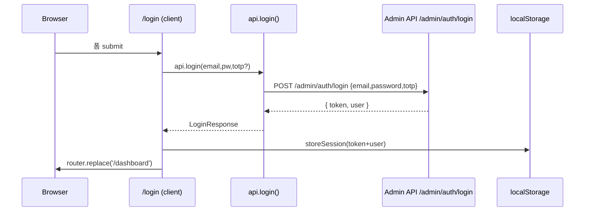
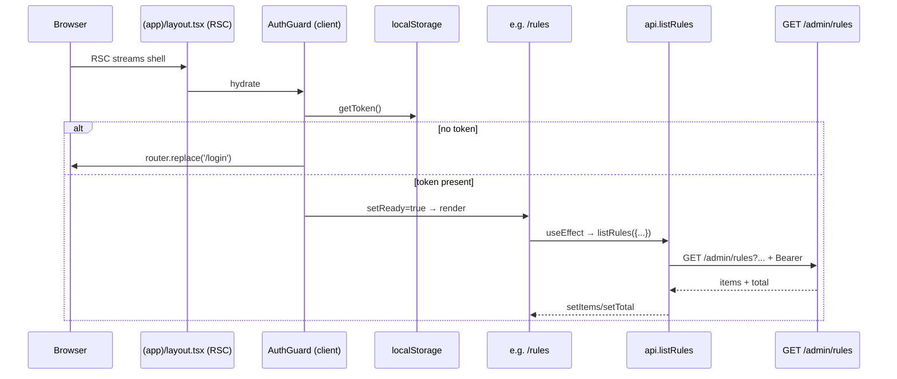
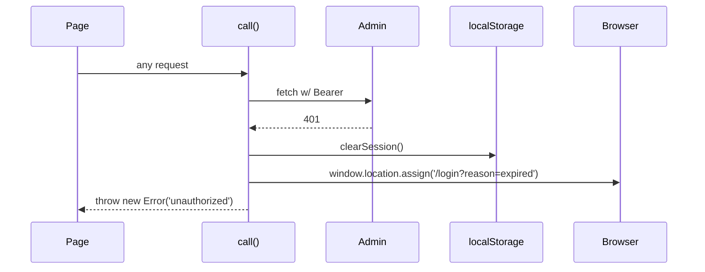
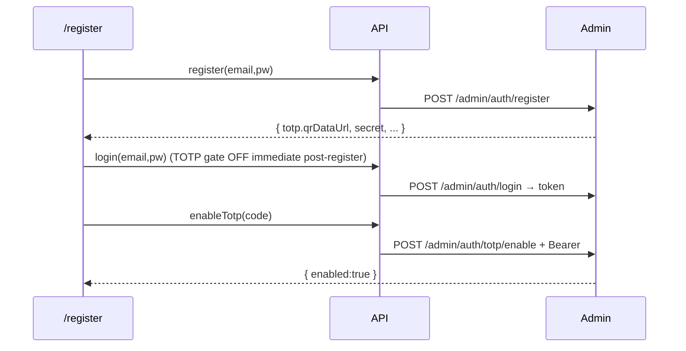

# CODE-REVIEW-Lv2 — Guardrails-Service-Admin-Web

| 항목 | 값 |
|---|---|
| 분석일 | 2026-05-20 |
| 대상 | `/Users/wise/Developer/Web(Node,Script)/Guardrails-Service-Admin-Web` |
| 리뷰 레벨 | 2 (line-by-line, security/architecture focused) |
| 분석 범위 | 선택된 파일 — 22 / 22 (전체) |
| 분석자 | Claude (Anthropic, Opus 4.7 1M) |
| 산출 루트 | `.review/CODE-REVIEW-Lv2/` |

이 보고서는 6개 병렬 코드리뷰 가운데 **Admin Web (Next.js 14 App Router)** 한 건의 결과입니다. 한국어를 주로 사용하며, 식별자/패턴 등 영문 표기를 함께 보입니다.

---

## 1. Executive Summary (요약)

Admin Web 은 Next.js 14 (App Router) 위에 얹힌 **순수 클라이언트 사이드 SPA에 가까운 콘솔**이다. 모든 `page.tsx` 가 `'use client'` 로 선언되어 있으며 서버 컴포넌트, 서버 액션, route handler, middleware 는 **하나도 존재하지 않는다**. 인증은 `lib/auth.ts` 가 `localStorage` 에 JWT 와 user 메타를 저장하고, `lib/api.ts` 의 단일 `call()` 헬퍼가 `Authorization: Bearer <token>` 헤더를 붙여 Admin API (`NEXT_PUBLIC_ADMIN_API_BASE_URL`, 기본 `http://localhost:8084`) 로 직접 요청한다. 401 응답 시 세션을 비우고 `/login?reason=expired` 로 강제 이동한다.

라우트는 두 그룹으로 나뉜다.
- `/login`, `/register` (auth shell)
- `(app)` 라우트 그룹 (`AuthGuard` + `Sidebar` 가 감싼 콘솔): `/dashboard`, `/rules`, `/rules/[ruleId]`, `/rules/new`, `/rules/import`, `/audit`, `/users`, `/settings`

규모는 매우 작다: 22개 소스 파일, 합산 약 1.6k LOC, 가장 큰 파일도 `RuleForm.tsx` 205 LOC 로 600 LOC 임계선 한참 아래. 즉 block-mode 적용 대상 없음, 모든 파일을 Level 2 단일 패스로 다뤘다.

설계는 **단순 + 솔직**하나, **클라이언트 측 인증 모델이 보안적으로 얕다**. JWT 를 `localStorage` 에 두는 것, role 기반 라우트 가드를 `Sidebar` 의 메뉴 필터/`/users` 페이지의 useEffect 내부 분기로만 수행하는 것, `next/image` 대신 `` 로 외부 데이터 URL QR 을 그대로 띄우는 것, CSRF 토큰을 보내지 않는다는 점 등은 백엔드(`Guardrails-Service-Admin`)의 보안 모델 가정에 강하게 의존한다. 또한 `next.config.mjs` 가 `NEXT_PUBLIC_ADMIN_API_BASE_URL` 을 빌드 시 정적으로 박는 구조라, "런타임 ARG vs Build ARG" 의 의도가 README 와 충돌하므로 운영 관점에서 주의가 필요하다.

---

## 2. Project Structure (프로젝트 구조)

### 2.1 Source Tree (depth 4, role notes)

```
Guardrails-Service-Admin-Web/
├── Dockerfile                 # multi-stage: deps → builder → runtime, standalone 모드
├── README.md                  # 운영/개발 가이드 (이번 리뷰에서는 *.md 제외)
├── next.config.mjs            # output=standalone, reactStrictMode, env 주입
├── package.json               # Next 14.2.5, React 18.3.1, TS 5.4 — devDeps 만, lock 없음
├── tsconfig.json              # strict, ES2022, paths "@/*"
├── next-env.d.ts              # (excluded)
├── .env.example               # PORT=3001, NEXT_PUBLIC_ADMIN_API_BASE_URL
├── .dockerignore
├── app/
│   ├── globals.css            # 다크 테마, KPI/카드/뱃지/탭/QR/toast 등 디자인 토큰
│   ├── layout.tsx             # RSC RootLayout (html lang="ko")
│   ├── page.tsx               # ['use client'] 홈 redirect → /login 또는 /dashboard
│   ├── login/page.tsx         # ['use client'] Login + Suspense(useSearchParams)
│   ├── register/page.tsx      # ['use client'] 3-step: form → totp → done
│   └── (app)/                 # route group: AuthGuard + Sidebar shell
│       ├── layout.tsx         # RSC. AuthGuard 가 자식
│       ├── dashboard/page.tsx # 'use client', KPI + 최근 로그인/감사
│       ├── rules/page.tsx     # 'use client', 목록/필터/벌크삭제
│       ├── rules/[ruleId]/page.tsx  # 'use client', 편집/삭제
│       ├── rules/new/page.tsx       # 'use client', 신규
│       ├── rules/import/page.tsx    # 'use client', CSV 업로드
│       ├── audit/page.tsx     # 'use client', login/actions 두 탭
│       ├── users/page.tsx     # 'use client', super_admin only
│       └── settings/page.tsx  # 'use client', TOTP, 비번 변경
├── components/
│   ├── AuthGuard.tsx          # 'use client' — useEffect 후 redirect
│   ├── RuleForm.tsx           # 'use client' — Rule ↔ form ↔ DTO 변환 + UI
│   └── Sidebar.tsx            # 'use client' — 네비 + 로그아웃
├── lib/
│   ├── api.ts                 # 'use client' — fetch 래퍼, 모든 API 메서드
│   ├── auth.ts                # 'use client' — localStorage 세션
│   └── types.ts               # 도메인 타입 (Rule, Severity, AuthedUser …)
└── public/                    # 빈 디렉터리 (.gitkeep)
```

**부재 확인**: `middleware.ts` 없음 → 서버 측 인증 경계 0. `app/api/**` route handler 없음. 서버 액션 없음. 테스트 디렉터리 없음 (`__tests__`, `*.test.tsx`, jest/vitest 설정 모두 부재).

### 2.2 Module Dependency Graph

```mermaid
flowchart LR
  subgraph app[Next.js App Router]
    A0[layout.tsx RSC]
    A1[page.tsx redirect]
    A2[login/page.tsx]
    A3[register/page.tsx]
    A4["(app)/layout.tsx RSC"]
    A5[(app)/dashboard]
    A6[(app)/rules]
    A7["(app)/rules/[ruleId]"]
    A8[(app)/rules/new]
    A9[(app)/rules/import]
    A10[(app)/audit]
    A11[(app)/users]
    A12[(app)/settings]
  end
  subgraph components
    C1[AuthGuard]
    C2[Sidebar]
    C3[RuleForm]
  end
  subgraph lib
    L1[api.ts]
    L2[auth.ts]
    L3[types.ts]
  end
  Backend[(Admin API\nNEXT_PUBLIC_ADMIN_API_BASE_URL)]

  A1 --> L2
  A2 --> L1 & L2
  A3 --> L1 & L2 & L3
  A4 --> C1 --> L2
  A4 --> C2 --> L2
  A5 & A10 & A11 & A12 --> L1 & L2 & L3
  A6 & A7 & A8 & A9 --> L1 & L3
  A7 & A8 --> C3 --> L3
  L1 --> L2
  L1 --> L3
  L1 --> Backend
```

핵심 관찰
- `lib/api.ts` 가 **단일 fan-out 허브** (in-degree 11)
- `lib/auth.ts` in-degree 7
- `lib/types.ts` in-degree 8 (타입만)
- 컴포넌트 ↔ 페이지 간에는 의존 사이클 없음
- 모든 페이지가 백엔드를 **클라이언트에서 직접** 호출 → BFF/route handler 계층 0

### 2.3 Call & Response Flow

**(a) Login flow**


**(b) Authed page render**


**(c) 401 자동 로그아웃**


**(d) Register + TOTP 등록**


### 2.4 Third-party Package Inventory

| 패키지 | 버전 | 사용처 | 역할 | 라이선스 |
|---|---|---|---|---|
| `next` | ^14.2.5 | 전체 | App Router, build/standalone | MIT |
| `react` | ^18.3.1 | 전체 | UI 런타임 | MIT |
| `react-dom` | ^18.3.1 | 전체 | DOM 렌더링 | MIT |
| `typescript` | ^5.4.0 | dev | 정적 타입 | Apache-2.0 |
| `@types/node` | ^20.11.0 | dev | Node 타입 | MIT |
| `@types/react` | ^18.3.3 | dev | React 타입 | MIT |
| `@types/react-dom` | ^18.3.0 | dev | DOM 타입 | MIT |

**관찰**: 외부 의존성이 **3개 (런타임)** 뿐이라 supply-chain 표면이 매우 좁다. 그러나 (i) lockfile (`package-lock.json` / `pnpm-lock.yaml` / `yarn.lock`) 부재 — `Dockerfile` 의 `npm install` 이 비결정적 빌드를 만든다. (ii) lint/test/format toolchain 없음 (eslint·prettier·jest 등 개발 의존성 없음) — `npm run lint` 는 next-lint 가 ESLint config 없이 동작하므로 사실상 noop 에 가깝다.

### 2.5 Data Flow

1. **빌드 시점**: `Dockerfile` 의 `ARG NEXT_PUBLIC_ADMIN_API_BASE_URL` → `ENV NEXT_PUBLIC_ADMIN_API_BASE_URL=$ARG` → `npm run build` 시 클라이언트 번들에 **문자열로 인라인**됨. 즉 런타임에 환경변수를 바꿔도 브라우저 번들은 그대로 옛 URL 을 사용.
2. **런타임 시점 (서버)**: `next.config.mjs` 의 `env` 블록은 빌드 시 `process.env.NEXT_PUBLIC_*` 을 가져와 그대로 노출. SSR 영역에서도 동일.
3. **인증 토큰**: `LoginResponse.token` 을 `localStorage['gr_admin_token']` 에 저장 → `api.call()` 가 매 요청 `Authorization: Bearer …` 헤더로 송부. **쿠키 미사용** → 자동 CSRF 방어가 적용되지 않지만, JSON+Bearer 패턴이라 폼-제출형 CSRF 는 무력화됨. 단 XSS 한 번이면 토큰 전량 탈취 가능.
4. **세션 메타**: `LoginResponse.user` 를 `localStorage['gr_admin_user']` 에 JSON 으로 저장 → `Sidebar` 와 `/users` 에서 role 분기에 사용. **클라이언트가 임의로 수정 가능** (`localStorage` 는 동일 출처 코드면 누구나 write). 따라서 role 기반 UI 노출은 cosmetic이며, 실제 권한 차단은 백엔드에 의존해야 한다.
5. **API 응답**: 401 → 자동 로그아웃 + redirect. 그 외 에러는 `err.message` 로 표면화. 응답 본문 파싱은 `safeJson` 으로 빈/비-JSON 응답을 견딘다.

### 2.6 Entrypoint List (numbered)

| # | 진입점 | 경로 | 종류 | 비고 |
|---|---|---|---|---|
| 1 | `/` | `app/page.tsx` | client redirect | token 유무 따라 /login or /dashboard |
| 2 | `/login` | `app/login/page.tsx` | client | Suspense (useSearchParams) |
| 3 | `/register` | `app/register/page.tsx` | client | 3-step wizard |
| 4 | `/dashboard` | `app/(app)/dashboard/page.tsx` | client (under AuthGuard) | KPI |
| 5 | `/rules` | `app/(app)/rules/page.tsx` | client | list/filter/bulk |
| 6 | `/rules/[ruleId]` | `app/(app)/rules/[ruleId]/page.tsx` | dynamic client | edit/delete |
| 7 | `/rules/new` | `app/(app)/rules/new/page.tsx` | client | create |
| 8 | `/rules/import` | `app/(app)/rules/import/page.tsx` | client | CSV upload |
| 9 | `/audit` | `app/(app)/audit/page.tsx` | client | 2 tabs |
| 10 | `/users` | `app/(app)/users/page.tsx` | client | super_admin only (cosmetic) |
| 11 | `/settings` | `app/(app)/settings/page.tsx` | client | TOTP/password |

서버 진입점(`route.ts`, `middleware.ts`) 없음.

---

## 3. File Selection (40 cap, all ≤ 600 LOC)

총 후보 22개 모두 cap 안. 우선순위(라우트 진입점 → lib → components) 그대로 채택. >600 LOC 임계 도달 파일 없음 → block-mode 트리거 없음.

선정 목록 (전부):

```
app/layout.tsx
app/page.tsx
app/login/page.tsx
app/register/page.tsx
app/(app)/layout.tsx
app/(app)/dashboard/page.tsx
app/(app)/rules/page.tsx
app/(app)/rules/[ruleId]/page.tsx
app/(app)/rules/new/page.tsx
app/(app)/rules/import/page.tsx
app/(app)/audit/page.tsx
app/(app)/users/page.tsx
app/(app)/settings/page.tsx
components/AuthGuard.tsx
components/RuleForm.tsx
components/Sidebar.tsx
lib/api.ts
lib/auth.ts
lib/types.ts
next.config.mjs
package.json
tsconfig.json
Dockerfile
.env.example
.dockerignore
app/globals.css   (보조 — security 검토만)
```

각 파일별 상세는 [`<root>_Abstract.md`](./_root_Abstract.md) 및 각 디렉터리 `_Abstract.md` 의 링크 트리에서 본다.

---

## 4. Whole-Codebase Synthesis (시너지 분석)

### 4.1 반복 패턴

- **모든 페이지가 `'use client'`** → App Router 의 RSC 이점(서버 사이드 데이터 페치, 토큰 미노출, 코드 스플릿)을 모두 포기. `(app)/layout.tsx` 와 `app/layout.tsx` 만 RSC.
- **`useEffect` + IIFE async** 패턴이 거의 모든 페이지에 동일하게 반복 (`useEffect(() => { (async () => { … })(); }, [...])`). 첫 렌더 → fetch → setState. 사후 가드/취소가 없어 unmount race 위험 (4.4 참조).
- **에러 핸들링**: `try/catch` → `setError((e as Error).message)`. 통일은 잘 되어 있으나, 구조화된 에러 코드/필드를 사용자가 못 본다 (백엔드가 `{message, error}` 이외 필드를 줄 때 표시되지 않음).
- **세션 메타 신뢰**: `Sidebar` 와 `/users` 모두 `getStoredUser().role === 'super_admin'` 으로만 가드. 사용자가 devtools 로 `localStorage.gr_admin_user` 를 바꾸면 메뉴/페이지 진입을 흉내낼 수 있다 (백엔드가 거부하므로 데이터 노출은 막힘).

### 4.2 계층 위반 (Boundary violations)

- **RSC/Client 경계의 비대칭**: `app/(app)/layout.tsx` 는 RSC인데 첫 번째 자식이 `AuthGuard`(`'use client'`)이고 그 안에서 `useEffect` 까지 도달해야 가시화가 된다 → **초기 페인트가 RSC 셸 + "로딩 중..." 텍스트 → 클라이언트 hydration 이후에야 보호된 콘텐츠로 전환**. 이로 인해 보호 페이지 직접 URL 진입 시 잠시 깜빡임/플래시(FOUC) 가 발생.
- **`lib/api.ts` 의 `'use client'` 선언**: 이 파일은 fetch 만 쓰므로 RSC 에서도 호출 가능하다. 그러나 `'use client'` 가 박혀 있어 서버 컴포넌트 / 서버 액션에서 import 하지 못한다 — 향후 BFF 도입을 막는 약한 잠금.
- **타입(`lib/types.ts`)의 모순**: `AuthedUser.status` 가 `string` 인데 가능한 값(active/disabled 등)이 union 으로 표현되지 않음. `Role` 은 union 으로 잘 잡혀있어 일관성 부족.

### 4.3 위험 핫스팟 Top-5

1. **`lib/api.ts` 의 `createRule`/`updateRule` 시그니처가 `rule: any`** (l.92, 94) — 모든 검증을 백엔드에 미루고 있다. `RuleFormValue → DTO` 단계에서 형이 깨져도 컴파일 통과.  ([api.ts.md](./lib/api.ts.md))
2. **`localStorage` JWT 저장 + role 메타 동시 저장** (`lib/auth.ts`) — XSS 한 발이면 토큰 전체와 권한 정보가 동시에 새어 나간다. CSP 헤더는 코드 어디에서도 설정되지 않으며 `next.config.mjs` 에 `headers()` 추가도 없다.  ([auth.ts.md](./lib/auth.ts.md))
3. **`Dockerfile` 이 lockfile 없이 `npm install`** + builder 단계에서 dev dependency 까지 통째로 들고 들어옴 — 비결정적 + 큰 이미지.  ([Dockerfile.md](./Dockerfile.md))
4. **`/rules/[ruleId]` 의 `decodeURIComponent(params.ruleId)`** — Next.js 가 이미 한 번 decode 한 값을 또 decode 함. `%2520` 처럼 이중 인코딩된 ruleId 가 들어오면 의도와 다르게 풀린다.  ([(app)/rules/[ruleId]/page.tsx.md](<./app/(app)/rules/[ruleId]/page.tsx.md>))
5. **`useEffect` 의 unmount race**: `dashboard`, `rules`, `audit`, `settings`, `users`, `register`, `[ruleId]` 모두 IIFE async fetch 후 `setState` 를 하면서 cancellation/`isMounted` 가드가 없다. 빠른 라우트 전환 시 "Can't perform a React state update on an unmounted component" 경고 + 잘못된 토스트가 표시될 수 있다.

### 4.4 기타 흔한 LLM/실수 패턴 검토

- **`dangerouslySetInnerHTML`, `eval`, `Function()`** — 코드베이스 전체에서 사용 사례 없음. PASS.
- **TOTP QR 을 ``** — `register/page.tsx` l.120, `settings/page.tsx` l.83 두 군데. 둘 다 `next/image` 대신 `` 사용으로 ESLint 규칙을 인라인 비활성화. 데이터 URL 자체는 백엔드에서 생성된 신뢰 가능 출처라 XSS 위험은 없으나, **백엔드를 신뢰**한다는 가정에 의존한다.
- **Open redirect**: `window.location.assign('/login?reason=expired')` 만 사용 (api.ts l.44). 외부 도메인 리다이렉트 없음.
- **하드코딩된 API URL**: `next.config.mjs`, `api.ts`, `Dockerfile` 세 곳에 `http://localhost:8084` 가 fallback 으로 박혀 있다. 빌드 시 ENV 가 누락되면 운영 이미지가 localhost 로 빌드되어 즉시 망가진다 (5.x 권고).
- **검증을 클라이언트에 미루는 패턴**: `RuleForm.safeJson` 은 파싱 실패 시 빈 객체로 fallback — 사용자 입력 JSON 이 잘못돼도 silent 로 `{}` 가 전송된다. 토스트로 알리지 않음.

### 4.5 삭제 후보

- `app/page.tsx` 의 redirect 로직은 `middleware.ts` 한 줄(미들웨어에서 `request.cookies.get('gr_admin_token')` 검사 후 NextResponse.redirect)로 대체 가능하나, 현재 구조상 토큰을 쿠키로 옮기지 않는 한 의미 없음. **삭제 권고 아님, 단 미들웨어 도입과 함께 폐기 가능**.
- `RuleForm.safeJson` 의 silent fallback — 삭제하고 throw 후 form 레벨 에러 처리로 일원화 권고.

### 4.6 테스트 공백

- **0 테스트**. Jest/Vitest/Playwright 흔적 없음.
- 권고: `lib/api.ts` 의 `buildUrl`, `safeJson`, `lib/auth.ts` 의 상태 전이, `RuleForm` 의 `ruleToForm`/`formToDto` 양방향(round-trip) 만이라도 단위 테스트.

### 4.7 다음 단계 (권장 우선순위)

1. **JWT 저장 방식**: httpOnly Secure SameSite=Lax 쿠키로 이동 + `middleware.ts` 도입 (서버측 인증 경계 확보). 현재 클라이언트 가드만 있는 구조는 운영 보안의 최소선 미달.
2. **lockfile 추가** + `npm ci` 사용 + `Dockerfile` 빌더 단계에서 `--omit=dev` 분리. CSP 헤더는 `next.config.mjs` 의 `async headers()` 로 주입.
3. **`createRule`/`updateRule` 타입화**: `RuleDto` 인터페이스를 `types.ts` 에 추가하고 `any` 제거.
4. **`useEffect` cancellation 패턴**: AbortController 또는 `let alive = true` 로 통일.
5. **role 가드의 서버측 검증 + middleware 동시 도입** 후 `getStoredUser` 기반 분기는 cosmetic 표시(메뉴 숨김)에만 사용한다고 명시.
6. **테스트 도입**: 위 4.6 항목으로 시작.

---

## 5. Appendices

### A. Deferred items
- README/CHANGELOG 등 `*.md` 는 본 리뷰 정책상 제외.
- 풀 트리: 다음 절 B 참조.

### B. Full Inventory

```
파일 수 (소스):
  .ts:    3   (lib/api.ts, lib/auth.ts, lib/types.ts)
  .tsx:  16   (app/**/*.tsx + components/*.tsx)
  .css:   1   (app/globals.css)
  .mjs:   1   (next.config.mjs)
  json:   2   (package.json, tsconfig.json)
  기타:   3   (Dockerfile, .env.example, .dockerignore)
```

상세 라인 수는 각 파일 리포트 헤더 참조.

### C. Glossary
(skip per instructions)

---

## 디렉터리 인덱스

- 루트: [`_root_Abstract.md`](./_root_Abstract.md)
- `app/`: [`app/app_Abstract.md`](./app/app_Abstract.md)
- `app/login/`: [`app/login/login_Abstract.md`](./app/login/login_Abstract.md)
- `app/register/`: [`app/register/register_Abstract.md`](./app/register/register_Abstract.md)
- `app/(app)/`: [`app/(app)/(app)_Abstract.md`](<./app/(app)/(app)_Abstract.md>)
- `components/`: [`components/components_Abstract.md`](./components/components_Abstract.md)
- `lib/`: [`lib/lib_Abstract.md`](./lib/lib_Abstract.md)
